# Data flow: AMOLF → SURF → Dropbox

Draft schematic. `?` = not yet confirmed.

```mermaid
flowchart LR
  subgraph AMOLF["AMOLF"]
    PRINCE["PRINCE (Prince2)<br/>plate images · ~0.8 GB each"]
    subgraph ARETHA["ARETHA"]
      TSU3["tsu-exp003 — plate-image mode<br/>~100 plates on regular schedule · ~1.5 GB each"]
      TSU2["tsu-exp002 — video mode<br/>4 microscope stations, high-mag video · ~0.14 GB each"]
    end
    subgraph HOST["Archiver stack (Docker, compose.prod.yml)<br/>IT-managed central server · specs: ask IT"]
      REDIS[("Redis<br/>stream dlm:new-imaging-event")]
      EXP["exporter<br/>tar per acquisition"]
      PUR["purger<br/>every 2 h, deletes raw<br/>after SRC_LIFESPAN (8 h)"]
      SM["state-manager<br/>Postgres + REST API"]
      EI["export-ingester<br/>ARQ cron (Europe/Amsterdam)"]
    end
    LOCAL["PROPOSED local compute server<br/>closed loop only<br/>1–2 GPU · ~64 cores · 5–10 TB NVMe (3 days raw)"]
  end

  subgraph SURF["SURF"]
    OS[("SURF Object Store<br/>s3://mycostreams-raw-data<br/>images/ · videos/ · overview/<br/>live rules: expire 7 d after archived=true,<br/>30 d after archived=false")]
    subgraph SNEL["Snellius"]
      ARCH["surf_archive<br/>staging · 1 task · 64G · ≤22 h"]
      OVW["daily_overview<br/>newest snapshot per plate → JPEG<br/>staging · 1 cpu"]
      DL["download + untar<br/>staging · 1 cpu · ≤50 jobs×20 objects<br/>≤1000 objects/run (tag processed≠true)"]
      ST["stitch (amftrack, dask, CPU)<br/>fat_rome · 128 cpu · 16 frames/job<br/>~48–68 GiB per frame"]
      VID["render mp4 per position<br/>(flow_analysis_comps)<br/>fat_rome · 128 cpu · 20/job"]
      UP["upload (rclone)<br/>staging · 1 cpu<br/>tag processed=true, rm scratch"]
      SCR[("/scratch-shared/amftrack_prod<br/>daily · daily_video<br/>purged after 14 d")]
      subgraph OND["On-demand analysis (manual orchestrator run, in campaigns)"]
        DLA["orchestrator download<br/>daget from tape · staging, 10 parallel"]
        STO[("STORAGE_PATH<br/>project space on /projects<br/>raw tiles ~1.6 GB/frame")]
        SG["spatial_graph per frame<br/>stitch → U-Net segment (85% of cost)<br/>→ skeleton → graph → widths<br/>fat_rome 16–32 cpu, 16–64 GB"]
        TG["temporal_graph per plate (STHype)<br/>fat_rome 16 cpu, 120–240 GB"]
        PF["polyflow per video<br/>wall U-Net → kymographs → orientations<br/>fat_rome 128 cpu, 240 GB"]
      end
    end
    TAPE[("SURF Data Archive (tape)<br/>/archive/mycostreams/<br/>images|videos/PLATE/YYYYMMDD.tar")]
    MQ{{"RabbitMQ (? where hosted)"}}
  end

  DBX[("Dropbox<br/>dropbox:/DATA/PRINCE_VISU<br/>III_EEEYYMMB/stitch/*.tif<br/>III_EEEYYMMB/video/*.mp4")]

  PRINCE -- "event per acquisition<br/>~50/day" --> REDIS
  TSU3 -- "event per acquisition<br/>~250/day" --> REDIS
  TSU2 -- "event per video<br/>~450/day" --> REDIS
  PRINCE -. CIFS .-> EXP
  TSU3 -. CIFS .-> EXP
  TSU2 -. "? mount" .-> EXP
  REDIS --> EXP
  REDIS --> PUR
  REDIS --> SM
  EXP -- "1 tar per event, continuous<br/>~0.47 TB/day" --> OS
  PUR -- "every 2 h: delete raw > 8 h old" --> AMOLF

  EI -- "daily 01:21 images · 18:21 videos ·<br/>22:21 overview (once enabled)" --> ARCH
  EI -- "daily 04:21 plates (repo says 11:21, #134) · 07:16 videos" --> DL
  EI -- "daily 08:16" --> OVW
  OS -- "newest overview per plate" --> OVW
  OVW -- "PLATE_OVERVIEW/EEE/plate_YYYYMMDD-HHMM.jpg,<br/>tag processed=true" --> DBX

  OS -- "pull day's tars" --> ARCH
  ARCH -- "nightly: 1 tar per plate-day" --> TAPE
  ARCH -- "tag archived=true" --> OS
  ARCH -- "done msg" --> MQ --> SM

  OS -- "boto3" --> DL --> SCR
  SCR --> ST --> UP
  SCR --> VID --> UP
  UP -- "daily: stitched tif + mp4" --> DBX
  UP -- "tag processed=true" --> OS
  TAPE -- "as needed: campaigns,<br/>~1–3 per month, recall by hand" --> DLA --> STO
  STO --> SG -- "graph.geojson" --> TG
  STO --> PF
  SG -- "graph.png/geojson, reports" --> DBX
  TG -- "stg.geojson, stg_store.h5" --> DBX
  PF -- "polyflow_analysis/" --> DBX
  DBX -. "graphs (rclone)" .-> TG

  REDIS -. "new-imaging-event (loop plates)" .-> LOCAL
  TSU3 -. "read raw tiles (LAN)" .-> LOCAL
  LOCAL -. "FUTURE closed loop, per loop-plate acquisition (< 1 h):<br/>stitch → segment+widths → graph<br/>→ interesting areas → video positions" .-> TSU2
  LOCAL -. "graphs, chosen positions" .-> DBX

  TAPE -. "manual re-ingest (daget)<br/>if a day missed its S3 window" .-> DL
```

## Daily schedule (export-ingester cron, Europe/Amsterdam)

The deployed images job runs at 04:21; `worker.py` says 11:21 and the difference is in no commit (#134).

| Time  | Job | Snellius resources |
|-------|-----|--------------------|
| 01:21 | `surf_archive --mode=images` → tape | staging, 1 task, 64G, ≤22 h |
| 04:21 | `daily.sh` (`SBATCH_COMMAND`) → download → stitch → Dropbox | staging launcher; fat_rome 128 cpu for stitching |
| 07:16 | `daily_videos.sh` → download → render mp4 → Dropbox | staging launcher; fat_rome 128 cpu for rendering |
| 08:16 | `daily_overview.sh` → newest overview per plate → JPEG → Dropbox `DATA/PLATE_OVERVIEW` | staging, 1 cpu |
| 18:21 | `surf_archive --mode=videos` → tape | staging, 1 task, 64G, ≤22 h |
| 22:21 | `surf_archive --mode=overview` → tape (empty ids as `overview/unassigned/`); off until `OVERVIEW_ARCHIVE_ENABLED=true` | staging, 1 task, 64G, ≤22 h |

Not run daily (on-demand, Snakemake/legacy): segmentation (U-Net, GPU H100), skeleton/graph (amftrack), temporal graph (STHype), flows.

## Measured volumes (state-manager DB, `event_archives.size`, last 90 days from 2026-10-12)

July starts mid-month; October is 12 days in. ARETHA (tsu-exp002/003) idle in October 2026 for maintenance.

| System | Type | Month | Acquisitions | TB | GB / active day | GB / acquisition | Plates |
|---|---|---|---:|---:|---:|---:|---:|
| PRINCE | stitch | 2026-07 | 1632 | 1.19 | 65.9 | 0.73 | 16 |
| PRINCE | stitch | 2026-08 | 1492 | 1.25 | 40.4 | 0.84 | 29 |
| PRINCE | stitch | 2026-09 | 149 | 0.13 | 4.3 | 0.87 | 10 |
| PRINCE | stitch | 2026-10 | 633 | 0.52 | 43.1 | 0.82 | 13 |
| tsu-exp002 | video | 2026-07 | 3634 | 0.38 | 21.2 | 0.11 | 12 |
| tsu-exp002 | video | 2026-08 | 14089 | 1.98 | 63.7 | 0.14 | 49 |
| tsu-exp002 | video | 2026-09 | 5357 | 0.76 | 33.0 | 0.14 | 20 |
| tsu-exp003 | stitch | 2026-07 | 3946 | 5.56 | 308.9 | 1.41 | 85 |
| tsu-exp003 | stitch | 2026-08 | 7727 | 11.24 | 362.7 | 1.46 | 122 |
| tsu-exp003 | stitch | 2026-09 | 2781 | 4.29 | 153.1 | 1.54 | 50 |

Longer view (state DB records start January 2026): Jan–Sep 2026 = 108 TB, ~12 TB/month, ~0.4 TB/day;
peak March 2026 = 22 TB (videos ~0.67 GB each that month); ARETHA plates 74%, video 15%, PRINCE 12%.
Monthly CSV and trend chart: docs repo, `presentations/2026-10-local-compute/data/transfer_monthly.csv`.

Derived (August, a typical busy month):
- **Ingest:** 14.5 TB/month → ~0.47 TB/day, peak day ~0.47 TB (exp003 363 + video 64 + PRINCE 40 GB). ~27 TB in 90 days.
- **Frames:** ~250 ARETHA plate frames/day + ~50 PRINCE frames/day.
- **If every frame got graph extraction:** only segmentation (~4 min/frame) runs on the GPU; graph extraction (~9 min on 16 cores) is CPU. ~240 frames/day ≈ 16 GPU-h + ~600 CPU core-h a day: one GPU, more cores. Closed loop alone (a handful of plates): 1 GPU.
- **Local hot storage (decided):** raw data only for ~3 days, for closed-loop plates; older data is archived. Even the *full* stream for 3 days is only ~1.5 TB, so size for all of it plus derived outputs (~5–10 TB usable).
- **Storage today:** S3 keeps 14 days ≈ 6.5 TB working set; keeping a year of raw ≈ 170 TB.

## Decisions so far

- Scope: daily ingest + on-demand analysis, plus a future closed loop on ARETHA (< 1 h, a handful of plates).
- Local hot storage holds ~3 days of raw data; older data is archived.
- Local server v1 = **closed loop only**. Existing exporter → S3 → Snellius → Dropbox/tape path unchanged for all plates. Loop results go to Dropbox; positions sent to ARETHA as a separate message.
- Local server is **owned and operated by AMOLF IT** (hardware, OS, GPU stack, backups); the group designs and deploys the software/pipelines (containers).
- Plate-wide on-demand analysis **stays on Snellius** (large compute grant to use up). Moving it local is a possible later expansion.

## Closed loop → ARETHA: candidate channels (undecided)

| Option | How | For | Against |
|---|---|---|---|
| Redis stream (e.g. `dlm:closed-loop-positions`) | Local server XADDs; ARETHA software consumes | Reuses existing connection + monitoring; built-in log; acks via consumer groups | ARETHA software must add a consumer |
| Watched folder | Local server drops a position-list file (CSV/JSON) on the tsu-exp003 share | Simplest for the instrument side; human-readable | Polling, no ack, partial-write races (write-then-rename) |
| REST/TCP API on ARETHA | Local server POSTs positions | Synchronous accept/reject | Needs a server in the acquisition software |
| MQTT / RabbitMQ | Publish to a topic ARETHA subscribes to | Standard lab-automation pattern | New broker / dependency |
| Human in the loop | Positions to Dropbox/Slack; operator queues them | Zero instrument changes; good first step | Not autonomous |

Also needed: pixel ↔ ARETHA stage-coordinate calibration (from `tile_config.json` + stage metadata).

## Draft requirements for the local server (closed loop v1)

- **GPU:** 1–2 cards, ≥40 GB memory each (segmenter peaked 19.35/20 GB on a Snellius MIG slice); A100/L40S/H100 class.
- **CPU/RAM:** ~64 cores, ≥256 GB RAM (graph steps ~20 GB/frame; stitch ~12 GB).
- **Storage:** 5–10 TB usable NVMe — 3 days of the full raw stream (~1.5 TB) plus derived outputs.
- **Network:** on the AMOLF LAN next to tsu-exp003 (10 GbE preferred: 1.5 GB frame ≈ 1–2 s vs ≈ 13 s on 1 GbE); reach Redis on the archiver server; outbound HTTPS for Dropbox (rclone).
- **Software platform (from IT):** Linux, NVIDIA driver + CUDA, Docker with GPU support, monitoring compatible with the existing Grafana Alloy setup.
- **Latency budget:** < 1 h acquisition → positions; measured ≈ 15 min/frame with GPU segmentation.

## Open items

- Archiver host specs and network link speed (1 vs 10 GbE): ask AMOLF IT.
- Where production RabbitMQ runs (`RABBITMQ_DSN` is set in the prod `.env`).
- On-demand `STORAGE_PATH`: assumed the project space on `/projects`.
